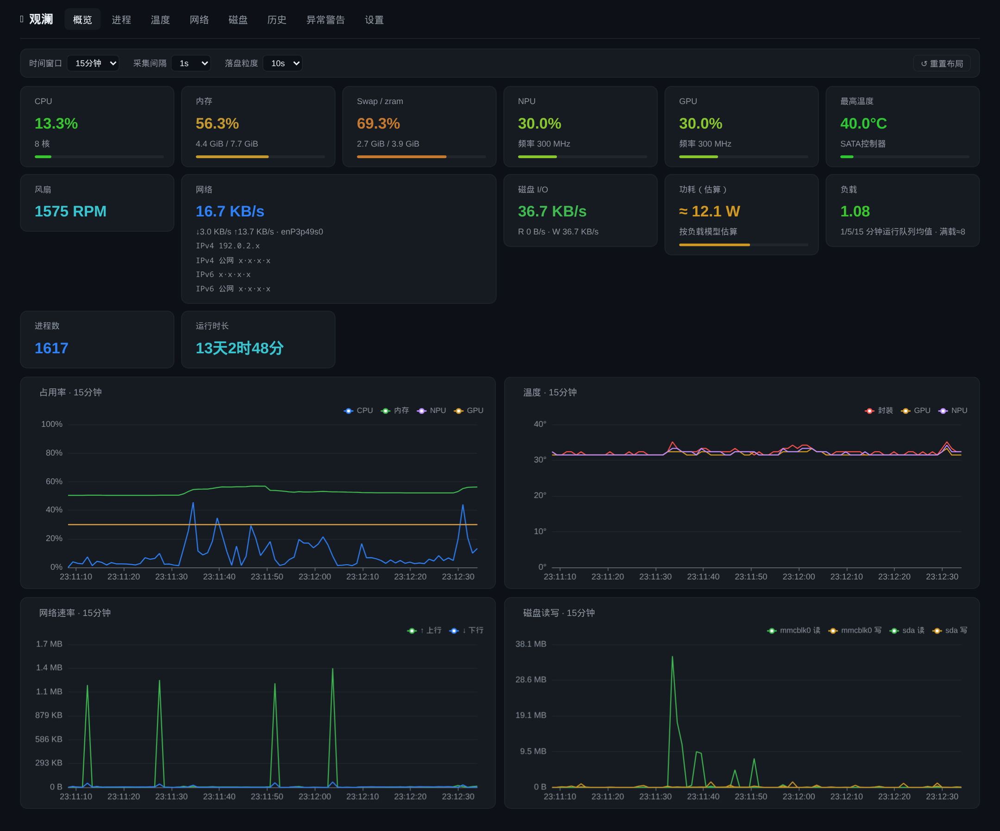
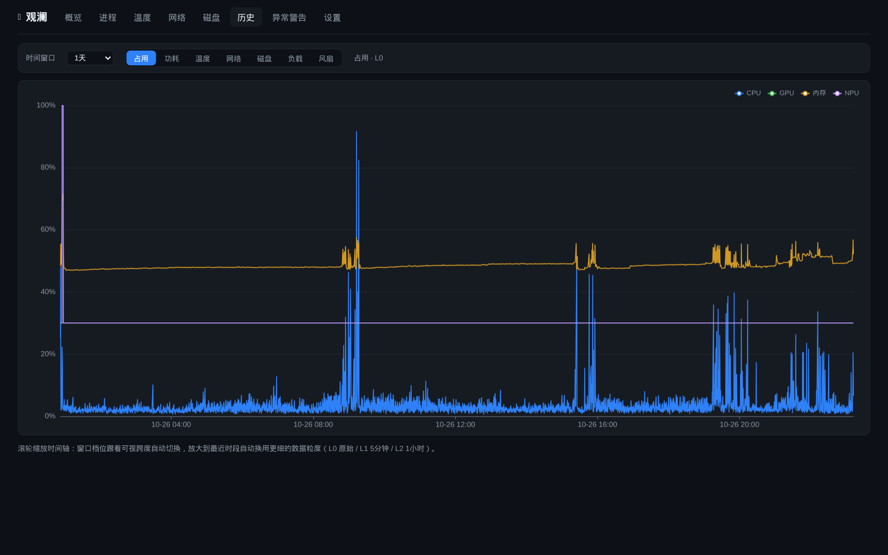
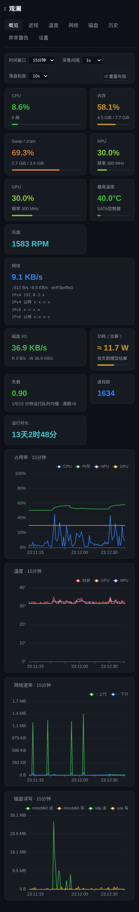

# 观澜 (Guanlan)

fnOS（飞牛OS）系统监控应用：像任务管理器一样实时总览 NAS 各项资源，并以多时间尺度
（10 秒 ~ 1 年）折线图记录与回看历史，带阈值告警与磁盘健康监视。

**仅 fnOS 管理员可用**（普通用户打开会被拒绝）。

| 概览 | 历史 |
|---|---|
|  |  |

<p align="center">
  
</p>

更多截图见 [docs/screenshots](docs/screenshots)。

## 安装

fnOS 应用中心安装 `guanlan.fpk`（GitHub Releases 下载），安装即用、无需配置。
桌面打开「观澜」图标。

局域网内也可以用手机/其他设备直接访问 `http://NAS的IP:9780`（只读，端口可在
应用中心-应用设置里修改）。

## 首次使用

1. **登录保护（推荐）**：从 fnOS 应用中心打开 → 设置 → 「远程访问登录」，设置
   用户名和密码并启用。之后直连端口打开页面会弹浏览器原生登录框（应用中心内
   打开不受影响）。
2. **磁盘空间保护（推荐）**：设置 → 「磁盘空间保护」，按数据盘大小填一个下限
   （如 5 GB）。空间不足时自动暂停历史落盘并在历史页提示，腾出空间后自动恢复。
3. 其余设置（采集间隔、落盘粒度、保留天数、告警规则）都有合理默认，可后续再调。

## 数据与备份

- 全部数据都在 `/vol1/@appdata/guanlan/`：`guanlan.db`（历史与配置，SQLite）、
  `guanlan.log`（运行日志）。卸载应用**不会删除**该目录。
- 备份：设置页可「导出配置」（JSON）与「导出历史」（SQLite 数据库文件）；
  直接停用应用后整目录拷贝也可以。
- 恢复：设置页「导入历史」选择之前导出的 `.db` 文件，校验预览后写入。

## 升级与卸载

- 升级：应用中心覆盖安装或卸载后重装 `guanlan.fpk`，数据目录保留，历史无缝延续。
- 卸载：应用中心卸载即可；如需彻底清理，手动删除 `/vol1/@appdata/guanlan/`。

## 功能

- **概览**：资源卡片（CPU/内存/Swap/NPU/GPU/温度/风扇/网络含 IPv4/IPv6 内外网
  地址/磁盘 I/O/功耗（估算）/负载/进程/运行时长），压力色自适应（绿→黄→红）；实时曲线窗口
  10 秒~24 小时可选；卡片与面板可拖拽排序（iOS 式让位动画）、面板高度/宽度可拖拽
- **温度 / 网络 / 磁盘**：独立页曲线，时间窗口为下拉框（10 秒~24 小时，与概览同一套）；
  磁盘健康信号（温度、I/O 错误计数、链路状态）与文件系统容量；全部传感器含中文说明
- **历史**：八组指标（占用/功耗/温度/网络/流量/磁盘/负载/风扇），窗口用下拉框选择，
  档位按组区分——温度/网络/磁盘为概览细档加长档（10 秒 / 30 秒 / 1 分钟 / 5 分钟 /
  15 分钟 / 1 小时 / 6 小时 / 1 天 / 1 周 / 1 月 / 1 年），占用/功耗/负载/风扇只有长档
  （10 分钟 / 1 小时 / 1 天 / 1 周 / 1 月 / 1 年），两套档位各自记忆上次选择；
  **滚轮缩放跟随鼠标、窗口档位随可视跨度自动切换**，跨层自动下钻到更细粒度
- **访问**：按来源 IP 汇总访问 NAS 的机器（1 小时~30 天），显示页面打开/请求/
  失败数、首次与最近访问、访问目标、客户端；失败 1~2 次标橙、3 次以上标红；
  表格按窗口高度收缩、在面板内滚动（表头吸顶）。
  数据来自 fnOS nginx 访问日志（覆盖全部 Web 应用）与观澜直连端口；日志只读、
  增量解析，首次启用导入最近 7 天；IPv6 按 /64 合并，聚合保留 90 天
- **进程**：只读列表，搜索/排序（排序方向有指示）、列宽可拖、表格同样面板内
  滚动（表头吸顶），CPU%/内存/Swap/状态（中文）/运行时长
- **异常警告**：阈值规则（指标/条件/持续 0~15 分钟/级别）可编辑；活跃告警 +
  历史 + 确认；有未确认告警时 tab 标红
- **设置**：采集间隔（1~15s）与落盘粒度（5~60s）运行时可调即时生效；三层保留
  策略可配；存储体积估算；配置导入导出；清空历史数据（二次确认）；
  直连端口的登录凭据与磁盘空间保护阈值也在设置页配置
- 界面中文 / English 切换

## 安全模型

- 桌面管理走 fnOS 统一网关（Unix socket），信任网关注入的管理员身份
- 独立 TCP 端口只做**局域网只读**镜像：能看数据，改配置/规则/清数据一律拒绝
  （网关身份头在 TCP 入口剥离，伪造无效）
- TCP 端口可加 **HTTP Basic 登录**：在设置页启用后，浏览器打开会弹原生登录框；
  凭据只存加盐摘要（不可逆），`/api/healthz` 保持免认证；同一来源连续失败 5 次
  暂停认证 60 秒（失败记脱敏日志，只记 IP）；改密码后旧凭据立即失效
- **磁盘空间保护**：可设剩余空间下限（GB），低于阈值时暂停历史落盘并在历史页提示，
  空间恢复后自动继续
- 写操作全部要求防跨站请求头；SQL 全参数化；无明文凭据；无特权运行

## 技术栈

Go 单二进制（CGO 关闭，arm64/amd64 双架构，前端 go:embed 嵌入）+ 纯 Go SQLite；
采集 `/proc` `/sys` 无特权可读面；分层时序存储（原始粒度×30 天 → 5 分钟×180 天 →
1 小时×365 天，滚动保留与自动降采样）。常驻内存 ~20MB、CPU <1%。
前端 Vue 3 + ECharts（按需引入）。

## 限制与注意事项

- NPU/GPU **利用率百分比**与 SMART 完整属性需 root，fnOS 第三方应用不可读；
  观澜以「实时频率÷最高频率」+ 专属温度曲线作 NPU/GPU 活动代理，以盘温、
  I/O 错误计数、链路状态、容量作磁盘健康信号
- **功耗为估算值**：本机没有功率计芯片（hwmon 只有温度/风扇/硬盘温度，
  Type-C PD 口未接时数值全 0，12V 输入只在 root 的 debugfs 里且没有电流读数），
  观澜按 CPU/GPU/NPU 负载与磁盘 I/O 的模型推算，界面标注「估算」并在悬停里
  说明误差约 ±30%——可看趋势，不能作为电费依据
- 每进程的磁盘读写与网络流量同样需要 root，进程页不可得（有页面说明）
- 公网访问需自行做端口转发/反代（fnConnect 中继不转发第三方应用端口）

## 常见问题

- **历史曲线只有很短一段？** 历史从安装时刻开始积累：1 月 / 1 年档由小时级聚合
  （L2）生成，需要运行满 24 小时才出现；刚装完看长档曲线短是正常的。
- **CPU 大于 100%？** 单核满载记 100%，8 核机器最高可到 800%。
- **功耗数字可信吗？** 是按负载模型推算的估算值（标注 ≈ 与 EST），看趋势可以，
  不能当电费依据，详见下方「限制与注意事项」。
- **忘了直连端口的登录密码？** 从 fnOS 应用中心打开观澜（这条通道不弹登录框），
  在设置页「远程访问登录」里改密码或点「关闭登录」。
- **手机上表格要左右滑动？** 有意为之：窄屏下保持每列可读宽度，而不是把内容
  压扁；列宽也可以在桌面端拖动调整。
- **磁盘保护触发了，历史断档了？** 空间恢复（或调低阈值）后自动继续，断档期间
  曲线是空的，但实时曲线一直正常。

## 开发与构建

```bash
./build.sh                      # 前端 → 嵌入 → 双架构 → fpk
./guanlan -dev -data ./data     # 本机直跑开发实例 http://IP:9780
cd server && go test ./...      # 单元测试
```

要求 Go ≥ 1.23、Node ≥ 18、npm、fnpack。架构决策与踩坑记录见
[DEVELOPMENT.md](DEVELOPMENT.md)，HTTP 接口说明见 [docs/API.md](docs/API.md)，
完整变更列表见 [CHANGELOG.md](CHANGELOG.md)。

## 许可

[PolyForm Noncommercial 1.0.0](LICENSE)——个人与非商业使用免费，商用需授权。
